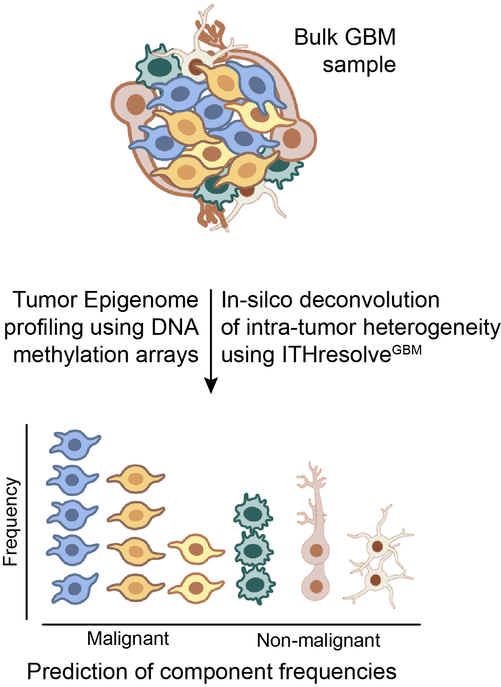

# ITHResolve-GBM

## Links

- **Paper:** [A cellular epigenetic classification system for glioblastoma](https://pmc.ncbi.nlm.nih.gov/articles/PMC13128495/) (*Neuro-Oncology*, 2026; DOI: 10.1093/neuonc/noaf299)
- **GitHub:** not yet publicly available

ITHResolve-GBM (ITHresolveGBM) is a hierarchical non-negative matrix factorization method that deconvolutes bulk DNA methylation profiles from glioblastoma tissue. It infers the relative abundance of microenvironmental cell types (glial, immune, neuronal) and further distinguishes the differentiation states of malignant cells, resolving intratumoral heterogeneity (ITH) directly from Illumina methylation array data.

In practice, it estimates tumor purity; quantifies the immune, glial and neuronal components of the tumor microenvironment, as well as the malignant component; and gives the ratio of stem-like to differentiated states within the malignant component.

## Applications

- Cell state-informed methylation classes (MCcsi) for patient stratification by predominant cellular states in primary and recurrent GBM (Ito et al.).
- Identification of a high-neural GBM state enriched for malignant stem/progenitor-like programs and reduced immune infiltration, associated with worse outcomes (Drexler et al., *Nature Medicine*, 2024).
- Multi-region GBM analysis showing the stem-like fraction is preserved across spatially distinct tumor regions and correlates with survival and MGMT status (Matsumoto et al., *Neuro-Oncology*, 2025).

## What this pipeline produces

- **Tumor composition scores** — per-subject methylation-class/cell-type composition measures, written to the pipeline's output directory.

## Input requirements

- IDAT epigenetic array files (Illumina methylation arrays), placed in the project's `idat/` directory.
- No participants.csv is required for this pipeline.

## Credits

NiChart wrapper built by Jakob Ito.
